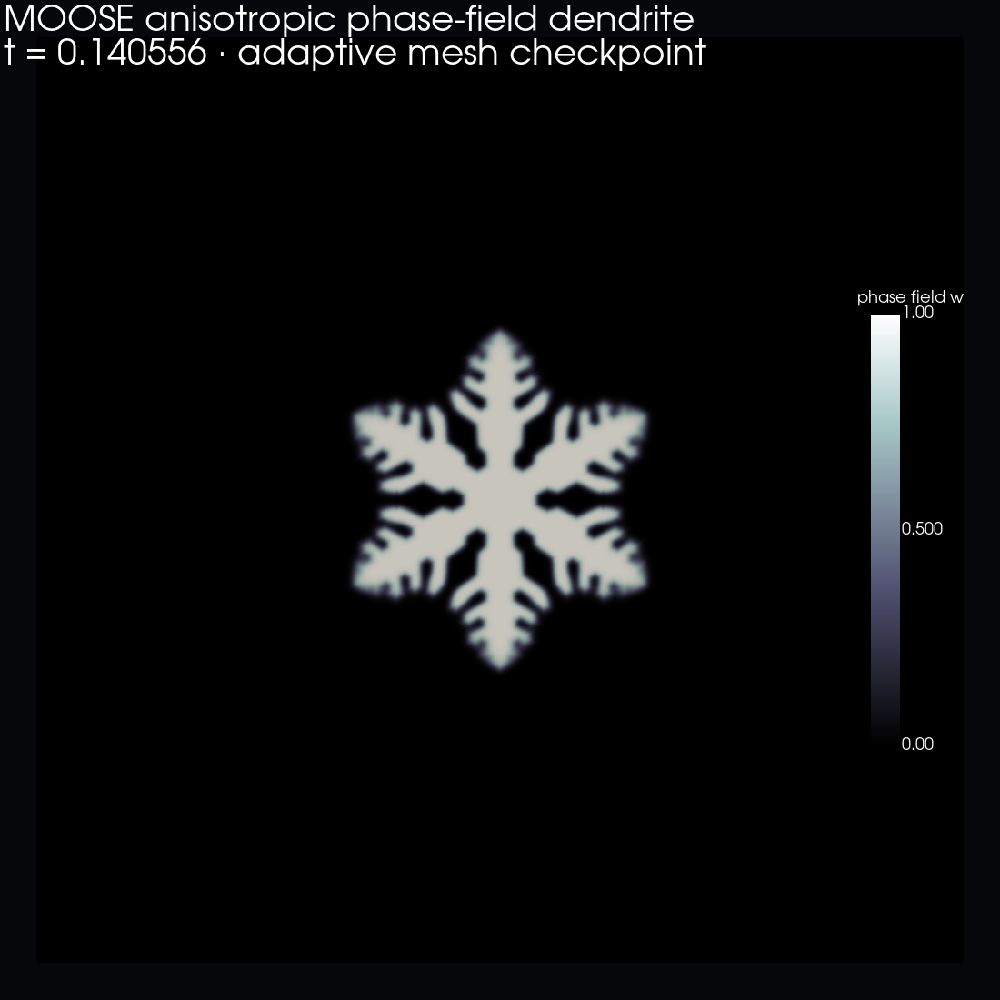
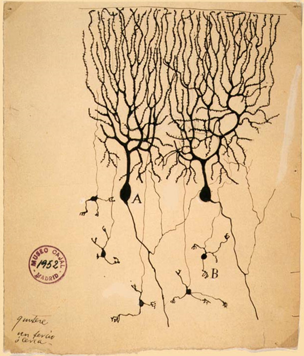
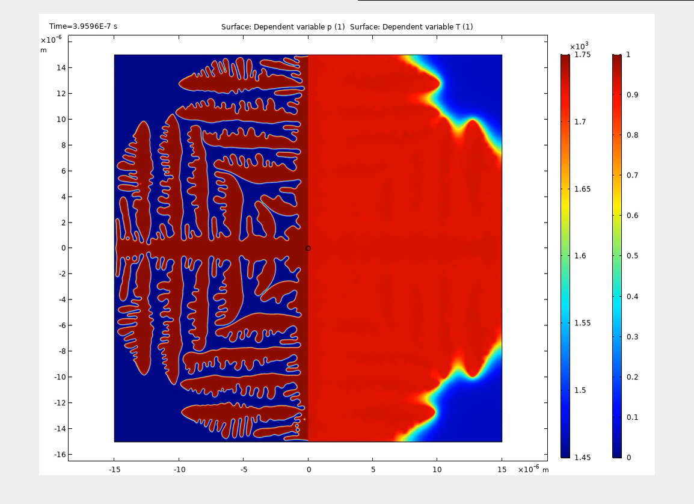
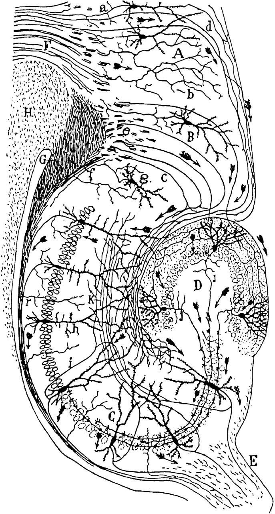
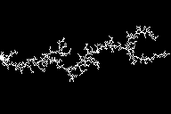
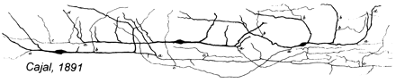

# Biological mirrors

The comparison is made at the level of branching geometry and feedback. Each
pair shows tips sampling a continuous field, branches competing for local
conditions, established growth altering neighboring conditions, and present
topology governing later transport. Cellular development, solidification, and
the reduced conductor model implement those relationships through distinct
material mechanisms.

| Computational anatomy | Biological anatomy |
|---|---|
|  **Sixfold phase-field arbor.** One seed develops primary trunks, secondary tips, and repeated branch spacing through local interfacial physics. |  **Purkinje-cell arbor.** Dendrites repeatedly divide to expose receptive surface across a planar field while preserving routes back to the soma. |
|  **Pure-nickel solidification front.** Thermal gradients, anisotropy, latent heat, and prior growth organize persistent advancing probes. |  **Hippocampal neural field.** Branching cells form layered paths whose geometry constrains direction, convergence, and recurrence. |
|  **Photon-conditioned conductor.** One advancing path branches, rejoins, and changes course as electrical, concentration, and optical fields change around it. |  **Cajal–Retzius trajectories.** Long horizontal neurites extend through tissue while emitting local branches that couple the traversed field to the cell. |

A branch is simultaneously a path, a receptive boundary, and a modification of
the field that guides later development.

## Measured human comparator

The H01 reconstruction provides a nanoscale public volume of one cubic
millimeter of human temporal cortex containing about 57,000 cells and 150
million synapses. It permits direct comparison of branch-length distributions,
taper, tortuosity, junction degree, and contact density rather than resemblance
alone.

Shapson-Coe, A., Januszewski, M., Berger, D. R., et al. (2024). [A petavoxel
fragment of human cerebral cortex reconstructed at nanoscale
resolution](https://doi.org/10.1126/science.adk4858). *Science, 384*, eadk4858.
[H01 public dataset](https://h01-release.storage.googleapis.com/landing.html).

## Figure provenance

The Cajal figures are public-domain scientific drawings. Full provenance and
the license for the COMSOL nickel frame are recorded in
[`figures/README.md`](figures/README.md).
