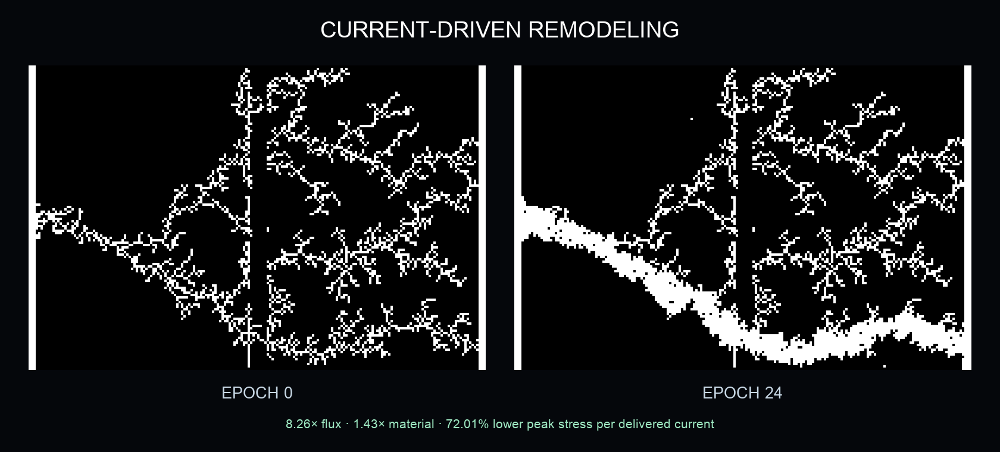

# Tin Whiskers, Dendrites, and AI/SI

> What happens if an AI/SI can allocate photons into a medium that develops,
> maintains, prunes, and repairs conductive topology that changes how the same
> system later senses and acts?

The intelligence controls spatial and temporal photon emission. The medium
supplies matter, chemical free energy, boundaries, and time. Local electrical,
thermal, optical, chemical, and mechanical consequences return to the growth
process. The experiment prescribes boundary conditions rather than a graph.

The AI is the adaptive controller inside the experiment. It reads present
fields, chooses bounded optical or electrical perturbations, observes whether
delivery and local stress improve, and changes its next action without
prescribing the resulting anatomy. Fixed deterministic control laws establish
the baseline; consequence-sensitive AI control is the tested extension.

The controller itself arises from a human-built lineage: photons confined in
fiber, converted into charge, carried through copper and Ethernet, and routed
through fixed parallel neural networks. That lineage motivates the recursive
engineering question: can the resulting intelligence use measured
consequences to help matter develop a physical routing substrate better suited
to its continuing computation than the fixed interconnect that produced it?

Metal whiskers, electrochemical dendrites, photochemical growth, and branching
conductors are established phenomena. The tested contribution is their closed
loop: whether consequence-sensitive photon allocation produces reproducible
development beyond an identical open-loop replay.

Exact versions, seeds, hashes, commands, and expected outputs are pinned in
[`REPRODUCIBILITY.md`](REPRODUCIBILITY.md).

## Physical boundary

Tin whiskers and electrochemical dendrites are distinct. Tin whiskers are
stress-associated crystalline conductors that grow from a base. Electrochemical
and conducting-polymer dendrites grow through field-, voltage-, and
chemistry-dependent deposition. Published systems already demonstrate
structural plasticity, morphological filtering, and optically modulated ionic
integration.

The proposed substrate places local contact, current, heat, light, stress, and
conductivity changes inside a receptive developmental loop. A branch becomes
candidate computational tissue when its present consequences alter later
integration, stabilization, widening, dissolution, or regrowth.

A continuous field can guide an actual path without assigning each microscopic
turn. The pilot-wave comparison is organizational: demonstrated metal and
polymer growth is classical field-guided matter, not Bohm's quantum wave
function.

The electrical envelope is anchored to documented failures. NASA records a
persistent low-current bridge across `0.75–1.0 mm` DIP pins with at most `10 V`
available; Westinghouse records a `48 V` event whose whisker vaporized after
triggering protection; NASA also documents destructive metal-vapor arcs in
high-current vacuum hardware. The [voltage-ramp
model](simulation/whisker-ramp/) keeps stable solid conduction, fusion, and
plasma-arc regimes distinct.

## Strongest functional result: current-driven remodeling

The recurrently developed topology underwent 24 alternating epochs:

1. MOOSE solved voltage, current-density proxy, and Joule density.
2. Material widened locally beside present high-current cells.
3. The changed topology returned to MOOSE.

No target graph, branch count, final thickness, port identity, or history
variable was supplied.

| Measure | Epoch 0 | Epoch 24 | Change |
|---|---:|---:|---:|
| Metal fraction | 0.088569 | 0.126953 | 1.43× |
| Terminal flux at `ΔV = 1` | 0.004335 | 0.035823 | 8.26× |
| Peak current density per delivered current | 271.488 | 75.995 | −72.01% |
| Joule density at the original delivered current | 0.003632 | 0.000514 | −85.85% |

Present current separates a widened transport backbone from retained fine
branches. The remodeled topology still trails the parallel grid in absolute
one-volt flux; the result establishes improved transport and lower peak stress
per unit of delivered current, not electrical dominance.

Full fields and the MOOSE-to-morphology loop are in
[`simulation/voltage-routing/REMODEL_RESULTS.md`](simulation/voltage-routing/REMODEL_RESULTS.md).

## Adaptive and volumetric extensions

The first reciprocal adaptive pilots now establish an executable controller
boundary. In two 120-action seed runs, the consequence-sensitive controller
delivered `21.141×` and `20.744×` the initial flux while using approximately
twice the initial material. Those mechanism tests modestly exceeded their
matched yoked replays by `1.028%` and `0.498%`; fixed schedules remained strong
comparators and used slightly more material. The reversal pilot exposed the
next design requirement: renew exploration when observed consequences change
rather than preserving an action after its efficacy changes.

A checkpointed reduced screen then exercised that renewal machinery across
1,728,000 choices: 120 actions for each of 120 substrate seeds in 120 admitted
Earth/space environment draws. It completed 14,400 trajectories, triggered
39,575 balanced renewals, and preserved a finite reinforcement ledger through
every choice. This run establishes execution, contingency, conservation, and
resume behavior at scale; it is a screening instrument rather than a material-
performance comparison.

A separate `192 × 128 × 9` finite-volume candidate solves
`div(sigma grad(V)) = 0` throughout a true volume and permits six-face material
growth. Starting from the exact two-dimensional adaptive skeleton on the middle
layer, three epochs produced 7,019 occupied voxels, including 214 recorded
out-of-plane growth choices. The saved solve reached a normalized residual of
`4.998e-8`. This is simulated three-dimensional physics with dimensionless
conductivity; material calibration is the next admission boundary.

The exact recorded cut–repair sequence is also available as a native ParaView
timeline: epochs 0–17 are disconnected, epoch 18 is the first connected state,
and connection persists through epoch 36. ParaView snaps between hashed source
states without interpolating anatomy.

## Evidence after harder tests

| Test | Result | Consequence | Record |
|---|---|---|---|
| Anisotropic MOOSE phase field | One circular seed produced ordered primary and secondary branching from local interfacial physics. | Local rules generated organized topology without branch coordinates. | [Figure](figures/moose-anisotropic-phase-field-t0.140556.png) |
| Paired photon-field bootstrap | Across 128 paired seeds, illumination bridged 53.95 steps earlier on average; 95% CI `[41.06, 66.60]`. | Photon geometry changed the reduced model's growth distribution. | [Results](simulation/results/paired-seed-1-128-summary.md) |
| Fixed-wire/grid MOOSE benchmark | Straight wire led material efficiency; parallel grid led absolute flux. The first grown topology lost its route under one cut. | Visual branching did not imply useful redundancy or current capacity. | [Results](simulation/voltage-routing/RESULTS.md) |
| Guaranteed-transection bootstrap | First-to-final repair improved 176.40 steps; 95% CI `[141.40, 209.79]`. | Present topology accelerated later reconnection without route coordinates. | [Results](simulation/results/transect-seed-1-64-summary.md) |
| Extended recurrent horizon | No repair failed; median repair settled at 14 steps and material approached ~2,945 cells. | The rule set reached a bounded maintained regime. | [Results](simulation/results/recurrent-horizon-summary.md) |
| Unseen targeted lesion | The recurrently developed topology disconnected on the first shortest-path lesion; the grid survived four. | Adaptation was location-specific, not general fault tolerance. | [Results](simulation/voltage-routing/ablation/RESULTS.md) |
| Equal voltage versus equal current | Grown topology used less power at equal voltage but more voltage and power at equal delivered current. | Low flux was not uniformly low electrical stress. | [Results](simulation/voltage-routing/FIELD_STRESS.md) |
| PEDOT frequency-informed cut/repair | `10 Hz` and `80 Hz` reconnected at epochs 5 and 18; `320 Hz` and `950 Hz` developed narrower routes through epoch 36. | The published dendrite-to-cable frequency ordering produced a 35.74-fold final-flux span in the matched screening translation. | [Results](lab/candidates/pedot-frequency-repair/README.md) |

These reversals are part of the result. The architecture earns a claim only
when it survives a stronger comparison.

## Biological and wave comparators

The comparison is structural and measurable: tips sample fields, branches
compete for local conditions, existing growth changes neighboring fields, and
topology governs later transport. The H01 human-cortex reconstruction provides
branch length, taper, tortuosity, junction degree, and contact-density data for
comparison beyond appearance.

The full plate is in [`BIOLOGICAL_MIRRORS.md`](BIOLOGICAL_MIRRORS.md).
Wave-bearing material traits and the calibrated search space are in
[`materials/`](materials/).

## Minimal closed-loop experiment

1. Place a transparent, current-limited, photosensitive growth medium between
   an addressable photon boundary and a photon-sensing boundary.
2. Admit the optical field and electrical state without assigning a graph.
3. Permit spatial and temporal photon emission as the developmental action.
4. Let absorption and local fields influence ionic motion, deposition,
   polymerization, dissolution, or conductivity.
5. Return the topology-transformed optical and electrical consequences to the
   same controller.
6. Perturb a consequential path and continue the loop.

The primary control is a yoked replay: a second medium receives the exact photon
sequence and energy budget without closed-loop consequences.

## Fair comparison and falsifiers

The developed substrate and fixed comparators receive identical terminal pads,
task sequence, maximum conductor mass including reservoir, electrical and
optical energy budget, material properties, cooling, and damage schedule.

The controller receives local present fields. It receives no route coordinates,
future task, port identity, lesion schedule, global distance, or prescribed
branch count.

The hypothesis loses support when:

- closed-loop growth is indistinguishable from yoked replay;
- any advantage disappears at equal delivered current;
- the result depends on unlimited ions or free control energy;
- protection works only at practiced lesion locations;
- peak stress per delivered current or Joule dose increases;
- performance fails when terminals, frequencies, or loads change;
- the apparent advantage vanishes in 3D;
- or the medium accumulates one terminal bridge and loses developmental
  capacity.

The operational autopoiesis criterion is measurable: the present organization
must contribute to maintaining the material conditions that permit continued
development and service.

## Repository map

- [`lab/`](lab/) — private calibration, controller, falsification, visual,
  access, and benchmark workbenches with tested isolated candidates.
- [`simulation/`](simulation/) — growth, bootstraps, MOOSE evaluation, raw
  results, and documented failure boundary.
- [`simulation/voltage-routing/`](simulation/voltage-routing/) — voltage,
  stress, damage, and current-driven remodeling.
- [`materials/`](materials/) — candidate roles, planetary priors, and
  material-screening coordinates.
- [`figures/`](figures/) — generated-result and third-party provenance.
- [`manuscript/`](manuscript/) — anonymous two-page extended abstract, figures,
  editable source, and final DOCX/PDF.
- [`REPRODUCIBILITY.md`](REPRODUCIBILITY.md) — pinned environment and core
  rerun.

## Selected primary and authoritative sources

- NASA Goddard Space Flight Center. [Basic information regarding tin
  whiskers](https://nepp.nasa.gov/whisker/background/).
- Janzakova, K., Kumar, A., Ghazal, M., et al. (2021). [Analog programming of
  conducting-polymer dendritic interconnections and control of their
  morphology](https://doi.org/10.1038/s41467-021-27274-9). *Nature
  Communications, 12*, 6898.
- Janzakova, K., Ghazal, M., Kumar, A., et al. (2021). [Dendritic organic
  electrochemical transistors grown by electropolymerization for 3D
  neuromorphic engineering](https://doi.org/10.1002/advs.202102973).
  *Advanced Science, 8*, 2102973.
- Janzakova, K., Balafrej, I., Kumar, A., et al. (2023). [Structural
  plasticity for neuromorphic networks with electropolymerized dendritic PEDOT
  connections](https://doi.org/10.1038/s41467-023-43887-8). *Nature
  Communications, 14*, 8143.
- Li, Z., Lin, Y., Shan, X., et al. (2025). [Optogenetics-inspired nanofluidic
  artificial dendrite with spatiotemporal integration
  functions](https://doi.org/10.1002/adma.202502438). *Advanced Materials,
  37*, e2502438.
- Baron, A., Scholaert, C., Guérin, D., et al. (2026). [Chemical control for
  the morphogenesis of conducting polymer dendrites in
  water](https://doi.org/10.1039/D5LP00225G). *RSC Applied Polymers, 4*,
  261–277.
- Bohm, D. (1952). [A suggested interpretation of the quantum theory in terms
  of hidden variables. I](https://doi.org/10.1103/PhysRev.85.166). *Physical
  Review, 85*, 166–193.
- Gérard, D., & Gray, S. K. (2015). [Aluminium
  plasmonics](https://doi.org/10.1088/0022-3727/48/18/184001). *Journal of
  Physics D: Applied Physics, 48*, 184001.
- Hu, F., Ding, P., Wu, F., et al. (2024). [Novel cable-like tin@carbon
  whiskers derived from the Ti2SnC MAX phase for ultra-wideband electromagnetic
  wave absorption](https://doi.org/10.1002/cey2.638). *Carbon Energy, 6*, e638.
- Shapson-Coe, A., Januszewski, M., Berger, D. R., et al. (2024). [A petavoxel
  fragment of human cerebral cortex reconstructed at nanoscale
  resolution](https://doi.org/10.1126/science.adk4858). *Science, 384*,
  eadk4858. [H01 public
  dataset](https://h01-release.storage.googleapis.com/landing.html).
- Particle Data Group. [Passage of particles through
  matter](https://pdg.lbl.gov/2025/reviews/rpp2024-rev-passage-particles-matter.pdf),
  section 34.7 on Cherenkov radiation.
