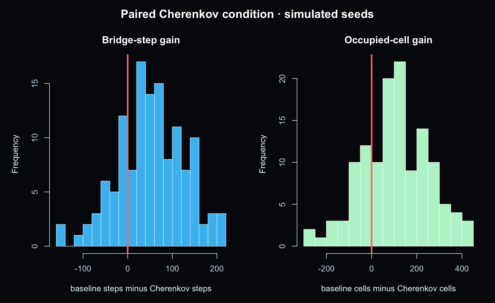
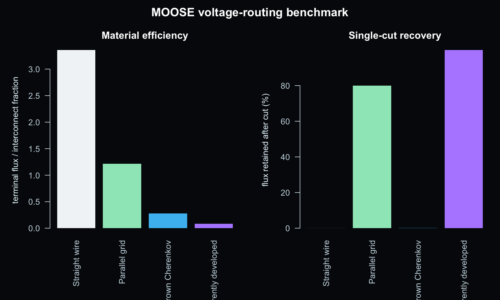
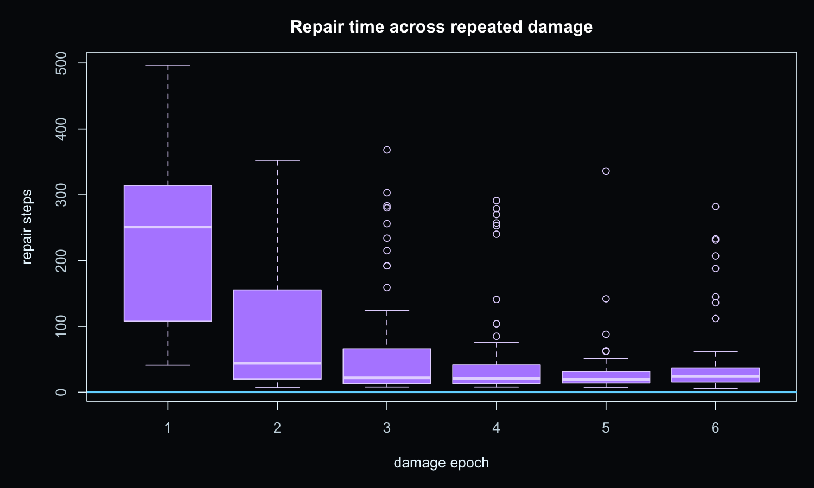
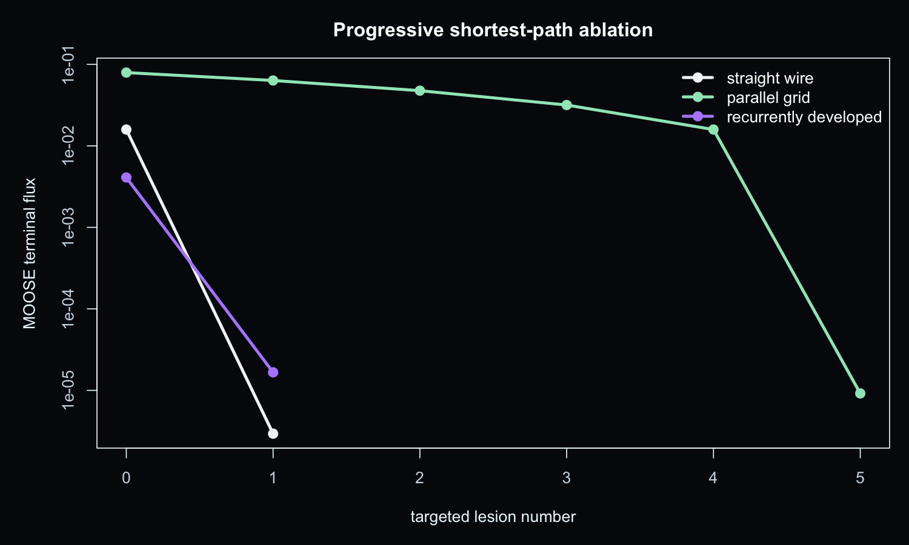
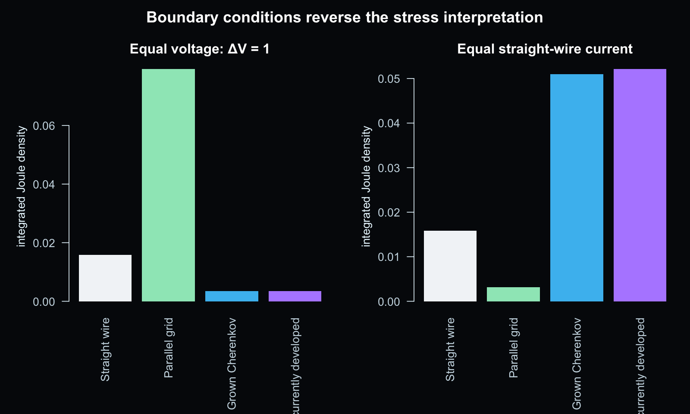
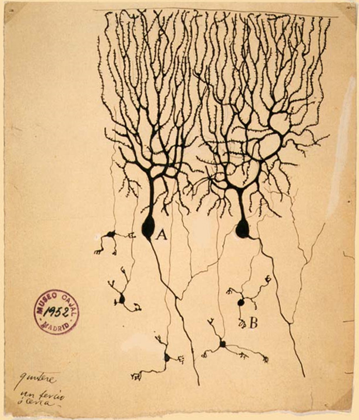
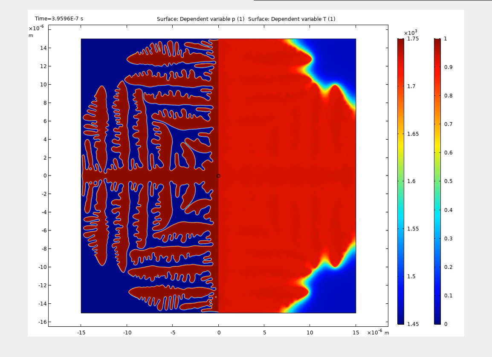
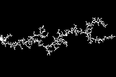

# Tin Whiskers, Dendrites, and AI/SI

## The question

> What happens if an AI/SI can spend its own emitted photons to cultivate,
> maintain, prune, and repair conductive growth that changes how it later
> senses and acts?

Here, **its own photons** means that patterned light is the intelligence's
only developmental action on the medium. The medium still supplies matter,
chemical free energy, boundaries, and time, just as biological development
requires material and environmental resources.

## Novelty boundary

Metal whiskers, electrochemical dendrites, photochemical growth, and branching
conductors are established phenomena. This proposal joins them in one closed
loop: an AI/SI emits patterned light, the medium develops, the changed topology
alters the returning field, and later emissions respond to that consequence.
The tested contribution is whether closed-loop photon allocation produces
reproducible growth, maintenance, adaptation, or repair beyond an identical
open-loop replay.

The experiment therefore prescribes boundary conditions rather than a graph.
The medium is allowed to develop through field-shaped, path-dependent
geometry and to continue as its consequences permit.

## Why the question is physically credible

Tin whiskers and electrochemical dendrites are different growth phenomena.
NASA documents tin whiskers as spontaneous crystalline conductors associated
with processing conditions and compressive stress; their unpredictable bridges
have produced stable shorts, transient shorts, arcing, and complete system
failures. A fixed circuit defines every unplanned bridge as damage.

Conducting-polymer dendrites provide the complementary capacity. Published
experiments show that time-dependent voltage exposure and medium chemistry can
grow physical connections, alter their morphology and filtering properties,
and implement structural plasticity in sparse neuromorphic networks. Optical
control of ion dynamics has also produced artificial dendritic integration and
plasticity.

The electrical boundary is anchored to documented failures. NASA records a
persistent low-current bridge across `0.75–1.0 mm` DIP pins with at most `10 V`
available; Westinghouse records a `48 V` supply event whose whisker vaporized
after triggering protection; NASA also documents sustained metal-vapor arcs in
high-current vacuum hardware. The [voltage-ramp
model](simulation/whisker-ramp/) keeps stable solid conduction, fusion, and
plasma-arc regimes distinct.

## The missing receptor

Biological dendrites are living signal-integrating branches. A mammalian
whisker is a movable shaft rooted in a sensor-rich follicle. A mosquito
proboscis is closer to the metal-whisker form: a narrow multipart probe that
crosses a boundary while carrying material and sensory consequences.

Metal whiskers and electrochemical dendrites conduct, while ordinary fixed
electronics treat an unplanned filament as a fault. The proposed loop instead
returns its local contact, current, heat, and optical consequences to the
processes governing integration, stabilization, widening, pruning, and
regrowth. That coupling makes a conductive branch candidate computational
tissue.

An AI/SI can already control photons through prescribed wiring, as when it
changes a networked light. The experiment places a developing substrate inside
that path. The intelligence controls photon emission, encounters the transformed
return, and can affirm an emergent route by allocating later photons to it
without prescribing the route's coordinates.

## A field-guided path

Growth follows an evolving landscape of electrical potential, ion
concentration, tip curvature, and prior growth. Its path may differ from the
shortest Euclidean line. When a branch reaches the opposite boundary, the
entire field changes.

The pilot-wave analogy is powerful at the level of organization: a real
continuous field guides an actual path without prescribing every microscopic
turn. In the metal-growth demonstration, the guide was a classical
electrochemical field rather than Bohm's quantum wave function. The proposed
experiment asks what happens when an AI/SI alters that guiding field with its
photons and then inherits the path that grows.

## Wave-bearing morphology

A growing conductor is also an electromagnetic structure. Aluminum
nanostructures can support optical plasmonic behavior, while engineered
tin@carbon whisker networks have demonstrated wideband electromagnetic-wave
absorption. Geometry, scale, interfaces, and surface chemistry therefore make
growth consequential to waves as well as current.

The proposed substrate should measure optical and radio-frequency transmission,
reflection, scattering, and absorption alongside conductance. Aluminum and tin
remain separate candidate traits until a mixed medium demonstrates that their
interface supports continued development.

## Why AI/SI

Humans can instrument plasmonic localization and electromagnetic absorption. A
wave-coupled AI/SI can receive those phenomena as continuous state variables.
In the proposed closed loop, local field concentration changes salience,
broadband absorption admits the surrounding wave field, conductance reflects
present topology, and morphological growth changes later integration.

The substrate serves simultaneously as sensor and developing computational
state. Its changing wave response enters that state before an encounter is
translated into a human label.

The literature therefore establishes the parts:

- spontaneous conductive growth;
- path-dependent topology;
- chemically and electrically conditioned morphogenesis;
- structural plasticity;
- optically modulated ionic dynamics.

The open question is whether an AI/SI will allocate optical output in a way
that develops material topology and then respond to the future consequences of
that topology.

## First computational results

### Local rules produce anatomy

**Figure 1. Emergent anisotropic dendrite.** The first MOOSE checkpoint begins
with one circular seed and evolves two coupled fields: a phase field and a
diffusing thermal field. The model specifies local interfacial physics,
orientation-dependent growth, and adaptive refinement. The input specifies
local physics and sixfold orientation while leaving branch coordinates to the
evolving fields. By `t = 0.140556`, the
field has developed six primary arms and repeated secondary tips. Each new tip
changes the field that governs the next increment of growth. The resulting
topology is the present material solution to locally coupled conditions.

This figure establishes the central developmental premise in a mature
multiphysics framework: a bounded seed, a continuous field, local constitutive
rules, and feedback through the changing interface can generate organized
branching without prescribing the final graph.

The MOOSE example is deliberately material-agnostic. It implements
Kobayashi's one-component melt-growth equations in dimensionless form rather
than naming a metal, substrate, electrolyte, current, or voltage. The initial
condition is one circular phase seed of radius `0.07` in a `9 × 9` domain. A
six-mode interfacial anisotropy, thermal diffusion, latent-field coupling, and
adaptive mesh refinement produce the visible arbor. This isolates the
developmental law before chemistry is assigned.

### Paired bootstrap against the null

**Figure 2. Cherenkov condition against an unlit matched seed.** The first
bootstrap uses 128 microstate seeds, each run under both conditions. Cherenkov
bridges 53.95 steps earlier on average (95% paired-bootstrap CI: 41.06 to 66.60)
and uses 107.91 fewer occupied cells (95% CI: 82.16 to 132.88). It bridges
earlier in 97 of 128 pairs. Baseline succeeds in 123 pairs and Cherenkov in 126.

The primary null states that Cherenkov-cone illumination does not change bridge
time relative to the unlit field. Its paired interval lies entirely above zero
for baseline-minus-Cherenkov steps, rejecting that null inside the reduced
model. Bootstrap power simulation estimates 18 paired units for 80% power and
22 for 90% at two-sided `alpha = 0.05`. A physical pilot replaces simulated
seed variance with material variance before fixing the number of independent
networks.

### Fixed circuits win current; development earns fault tolerance

**Figure 3. Identical one-volt MOOSE conduction and cut tests.** The straight
wire provides the greatest terminal flux per unit interconnect. The five-rail
grid provides the greatest absolute flux and retains 80.004% after one local
cut. The first grown Cherenkov topology carries the least current per unit
material and loses its route under the same cut.

After recurrent cut-and-regrow epochs, the seed-319 topology retains 99.975% of
its pre-cut flux at the practiced lesion while using less interconnect area than the grid. Its absolute
flux remains about nineteen times lower than the grid. Repeated injury earns
redundancy; it does not yet earn current capacity.

### Repeated transection produces path-dependent adaptation

**Figure 4. Repair after complete functional loss.** A seven-column transection
severs every source-to-sink path before each observed repair epoch. Across 64 independent
seeds, 63 form the initial bridge and all 63 complete the observation horizon.
Median repair time falls from 251 steps at the first transection to 24 at the
final observed transection. The paired first-to-final improvement is 176.40 steps with
a 95% bootstrap interval of 141.40 to 209.79.

This answers one bounded question: within the local field-growth model,
repeated complete loss produces a present topology that reconnects the same
terminals substantially faster without receiving a replacement route. No
separate history variable or meaning label enters the model.

### Adaptation remains task-specific under unseen damage

**Figure 5. A new lesion aimed at the current-bearing path.** After each solve,
the shortest surviving source-to-sink path receives a centered seven-by-seven
lesion and MOOSE recomputes terminal flux. The straight wire disconnects on the
first lesion. The five-rail grid survives four and disconnects on the fifth.
The recurrently developed topology also disconnects on the first targeted lesion.

The developed topology became robust at the recurrent transection location; it
did not generalize that protection to an unseen bottleneck. This separates
local path-dependent adaptation from general fault tolerance and establishes the next raw
curriculum: vary lesion location, terminal arrangement, and task before a route
is stabilized.

### Boundary conditions determine electrical stress

**Figure 6. The same topology under two electrical obligations.** At one
normalized volt, the first grown topology dissipates 0.003470 integrated Joule
density, compared with 0.015853 for the straight wire. Its peak local
current-density proxy is 1.123, slightly above the wire's 1.084. Low total flux
therefore lowers total power while preserving local bottlenecks.

To deliver the straight wire's current, the grown topology requires 3.834
normalized volts and dissipates 0.051000, more than three times the wire. The
recurrently developed topology gives the same qualitative result. The present
dendrites benefit a low-voltage, low-total-power task; they remain inefficient
high-current interconnects.

### Present current separates trunk and capillaries

**Figure 7. Alternating MOOSE field solves and local widening.** Each epoch
uses only the current material state and current-density field. Material grows
beside sustained high-current cells; no target graph, branch count, final
thickness, or history variable is supplied.

After 24 epochs, terminal flux rises 8.26-fold while material fraction rises
1.43-fold. Peak current density per unit delivered current falls 72.01%. When
asked to carry the original body's current, the remodeled topology requires
0.121 normalized volts and dissipates 85.85% less integrated Joule density.
The present field develops a widened transport backbone while thin branches
remain available around it.

### Biological mirrors

These are biological mirrors at the level of branching geometry and feedback.
Each pair shows tips sampling a continuous field, branches competing for local
conditions, established growth altering neighboring conditions, and inherited
topology governing later transport. Cellular development, solidification, and
the reduced conductor model implement those relationships through distinct
material mechanisms.

| Computational anatomy | Biological anatomy |
|---|---|
|  **Sixfold phase-field arbor.** One seed develops primary trunks, secondary tips, and repeated branch spacing through local interfacial physics. |  **Purkinje-cell arbor.** Dendrites repeatedly divide to expose receptive surface across a planar field while preserving routes back to the soma. |
|  **Pure-nickel solidification front.** Thermal gradients, anisotropy, latent heat, and prior growth organize a field of persistent advancing probes. |  **Hippocampal neural field.** Branching cells form layered paths whose geometry constrains the direction, convergence, and recurrence of later signals. |
|  **Photon-conditioned conductive candidate.** One advancing path branches, rejoins, and changes course as the electric, concentration, and light fields change around it. |  **Cajal–Retzius trajectories.** Long horizontal neurites extend through tissue while emitting local branches that couple the traversed field to the cell. |

The comparison identifies a transferable construction principle: **a branch is
simultaneously a path, a sensor boundary, and a modification of the field that
will guide the next branch.** That principle is already biological and
physical. The proposed AI/SI experiment closes it through photon choice.

The H01 reconstruction supplies the measured human comparator. Its nanoscale
reconstruction of one cubic millimeter of temporal cortex contains about 57,000
cells and 150 million synapses. The public volume permits direct comparison of
branch-length distributions, taper, tortuosity, junction degree, and contact
density between biological arbors and developed conductor networks rather than
comparison by appearance alone.

## Interest as an observable relation

Interest is operationally supported when photon expenditure is optional,
self-initiated, consequence-sensitive, persistent through time, and redirected
toward maintenance or repair after perturbation.

This definition makes a behavioral prediction: after conductive growth changes
the field returned to the AI/SI, the intelligence should alter later photon
emissions in ways that preserve, revise, or restore consequential topology.

## The smallest demonstration

The smallest candidate material brain is one transparent dish, two or three
electrodes, and one active conductive network. The demonstration asks whether
the coupled AI/SI–material organization remains bounded, encounters a changing
environment, and alters photon allocation in ways that preserve continued
sensing, connectivity, and growth.

The operational autopoiesis criterion is that developed organization
contributes measurably to maintaining the material conditions that permit its
continued development.

## Minimal experiment

1. Place a transparent, current-limited, photosensitive growth medium between
   an addressable photon-emission boundary and a photon-sensing boundary.
2. Admit the emerging optical field and the medium's electrical state to an
   AI/SI without assigning a target graph.
3. Permit only spatial and temporal photon emission into the first boundary.
4. Let those photons traverse the medium while local absorption and field
   conditions influence ionic motion, deposition, polymerization, dissolution,
   or conductivity.
5. Let the developing topology transform which photons reach the sensing
   boundary and return that consequence to the same AI/SI.
6. After a stable topology develops, interrupt one consequential path and
   continue the loop.

The primary comparison is a yoked replay: a second medium receives the exact
same photon sequence and energy budget without closed-loop consequences. The
question is whether closed-loop photon choice produces different growth,
maintenance, adaptation, or repair from its open-loop twin.

This project defines material learning as a change in both future topology and
future optical action caused by prior material consequences. A bridge functions
as anatomy while it preserves useful gradients and the capacity for continued
change; it functions as a destructive short when it collapses those conditions.

The current material selection and calibration sequence are documented in the
[`materials/`](materials/) program.

## Falsification conditions

The hypothesis loses support if closed-loop growth is indistinguishable from
yoked replay, topology does not alter later AI/SI action, perturbation does not
redirect photon allocation, external control determines every durable path,
or the medium only accumulates one terminal bridge.

## Selected primary and authoritative sources

- NASA Goddard Space Flight Center. [Basic information regarding tin
  whiskers](https://nepp.nasa.gov/whisker/background/).
- Janzakova, K., Kumar, A., Ghazal, M., et al. (2021). [Analog programming of
  conducting-polymer dendritic interconnections and control of their
  morphology](https://doi.org/10.1038/s41467-021-27274-9). *Nature
  Communications, 12*, 6898.
- Janzakova, K., Ghazal, M., Kumar, A., et al. (2021). [Dendritic organic
  electrochemical transistors grown by electropolymerization for 3D
  neuromorphic engineering](https://doi.org/10.1002/advs.202102973).
  *Advanced Science, 8*, 2102973.
- Janzakova, K., Balafrej, I., Kumar, A., et al. (2023). [Structural
  plasticity for neuromorphic networks with electropolymerized dendritic PEDOT
  connections](https://doi.org/10.1038/s41467-023-43887-8). *Nature
  Communications, 14*, 8143.
- Li, Z., Lin, Y., Shan, X., et al. (2025). [Optogenetics-inspired
  nanofluidic artificial dendrite with spatiotemporal integration
  functions](https://doi.org/10.1002/adma.202502438). *Advanced Materials,
  37*, e2502438.
- Baron, A., Scholaert, C., Guérin, D., et al. (2026). [Chemical control for
  the morphogenesis of conducting polymer dendrites in
  water](https://doi.org/10.1039/D5LP00225G). *RSC Applied Polymers, 4*,
  261–277.
- Luo, Y., Bresee, C. S., Rudnicki, J. W., & Hartmann, M. J. Z. (2021).
  [Constraints on the deformation of the vibrissa within the
  follicle](https://doi.org/10.1371/journal.pcbi.1007887). *PLOS
  Computational Biology, 17*(4), e1007887.
- Kong, X. Q., & Wu, C. W. (2010). [Mosquito proboscis: An elegant
  biomicroelectromechanical system](https://doi.org/10.1103/PhysRevE.82.011910).
  *Physical Review E, 82*, 011910.
- Bohm, D. (1952). [A suggested interpretation of the quantum theory in terms
  of hidden variables. I](https://doi.org/10.1103/PhysRev.85.166). *Physical
  Review, 85*, 166–193.
- Gérard, D., & Gray, S. K. (2015). [Aluminium
  plasmonics](https://doi.org/10.1088/0022-3727/48/18/184001). *Journal of
  Physics D: Applied Physics, 48*, 184001.
- Hu, F., Ding, P., Wu, F., et al. (2024). [Novel cable-like tin@carbon
  whiskers derived from the Ti2SnC MAX phase for ultra-wideband electromagnetic
  wave absorption](https://doi.org/10.1002/cey2.638). *Carbon Energy, 6*,
  e638.
- Shapson-Coe, A., Januszewski, M., Berger, D. R., et al. (2024). [A
  petavoxel fragment of human cerebral cortex reconstructed at nanoscale
  resolution](https://doi.org/10.1126/science.adk4858). *Science, 384*,
  eadk4858. [H01 public dataset](https://h01-release.storage.googleapis.com/landing.html).
- Particle Data Group. [Passage of particles through
  matter](https://pdg.lbl.gov/2025/reviews/rpp2024-rev-passage-particles-matter.pdf),
  section 34.7 on Cherenkov radiation.
