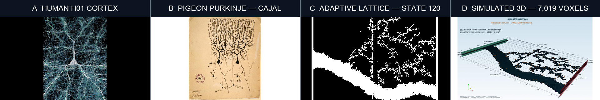
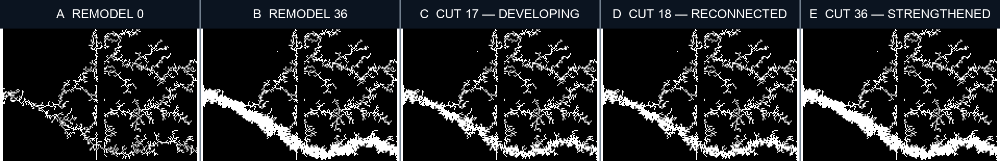

## Abstract

We test whether bounded feedback can help a conductive medium develop useful topology while matter determines its anatomy. Dimensionless conduction solves drive local growth; an adaptive controller selects equal-energy optical allocations from present field consequences, while fixed rules and reciprocal yoked replay provide controls. A fixed two-fiber control increased terminal flux 8.43-fold and reduced peak current density per delivered current by 75.29%. After a literal transection, the same rule restored connection at epoch 18 and finished at 8.339-fold flux with 74.978% lower concentration. In two 120-action trials, adaptive control exceeded reciprocal yoke in delivery while recruiting less material than the higher-flux fixed control. A separate 192 × 128 × 9 finite-volume probe recorded 214 out-of-plane growth choices. Together, these results establish a reproducible simulation platform for consequence-sensitive material development and repair.

*Keywords:* adaptive control; artificial dendrites; conductive remodeling; repair; structural plasticity

## Development as a control problem

Conducting-polymer dendrites can be grown and morphologically tuned by electrical stimulation, and later work demonstrates structural plasticity in PEDOT networks (Janzakova et al., 2021, 2023). We ask whether present electrical consequences can guide subsequent bounded stimulation while matter determines the resulting branches. The AI is the adaptive controller: it observes current, heating, delivery, and resource summaries and chooses between fixed optical footprints. Existing sinusoidal and current-driven rules remain controls. Biological arbors provide measurable geometric comparators—branch length, taper, tortuosity, and junction degree—while each material mechanism remains independently labeled (Figure 1).

*Figure 1.* Independently scaled branching systems: (A) H01 human cortex (Shapson-Coe et al., 2024; Google Research/Lichtman Laboratory, CC BY 4.0); (B) Cajal’s public-domain pigeon Purkinje arbor; (C) the literal 192 × 128 lattice after 120 adaptive actions; and (D) the 192 × 128 × 9 finite-volume body seeded from C at *z* = 4 and developed through 214 ±*z* choices.

## Methods and measured simulation

The dimensionless model solves steady conduction with common source and sink boundaries, maps local current back to adjacent-growth probability, and retains literal occupied cells. The adaptive contextual bandit receives fixed-footprint summaries limited to present field consequences. Each 120-action adaptive sequence is replayed on the reciprocal material seed with identical energy, forming the causal yoke. Fixed controls use the same physics and budgets with predeclared schedules. The volumetric probe solves div(σ∇*V*) = 0 by finite volume on six faces; its final body contains 7,019 voxels across *z* = 2–6. Material translation remains testable: aqueous PEDOT:PSS is the Earth proof-of-principle candidate, while a capped Ag/Ag-doped Ge₃₀Se₇₀ conductive-bridge array is the vacuum candidate.

## Results and utility

The 36-epoch fixed two-fiber control produced 8.427859× initial flux with 1.444717× material and 75.292797% lower peak current density per delivered current. Beginning from a verified disconnected cut, the same rule remained disconnected through epoch 17, reconnected at epoch 18, and finished at 8.339× flux, 1.445× material, and 74.978% lower concentration (Figure 2).

Across seeds 319 and 571, the 120-action adaptive arms reached 21.141× and 20.744× flux versus 20.926× and 20.641× for reciprocal yokes: gains of 1.028% and 0.498%. Fixed controls reached 21.858× and 21.487× while using 1.90% and 1.68% more material than adaptive, revealing a delivery–material Pareto tradeoff. Under a concealed epoch-60 channel attenuation, adaptive remained 1.033% and 0.495% above yoke while preserving its learned upper-heavy action. This reversal identifies contingency renewal as the next controller capability.

*Figure 2.* Fixed-rule remodeling and repair. (A–B) Delivery increased 8.43-fold while peak current density per delivered current fell 75.29%. (C–E) A separately cut lattice first reconnected at epoch 18 and strengthened through epoch 36, reaching 8.339-fold flux and 74.978% lower concentration. White pixels are occupied cells.

## Conclusion

These simulations show that local field-driven growth can widen transport, reduce concentration per delivered current, and reconnect a cut lattice. Adaptive control produced a measurable advantage over reciprocal replay in both developmental seeds and identified contingency renewal as the next developmental capability. The next decisive experiment is a calibrated physical PEDOT cell with matched adaptive, fixed, and yoked arms under concealed load and damage schedules.

## References

Anonymous. (2026). *Tin whiskers, dendrites, and AI/SI* [Software, data, and experimental record; blinded repository].

Janzakova, K., Kumar, A., Ghazal, M., Susloparova, A., Coffinier, Y., Alibart, F., & Pecqueur, S. (2021). Analog programing of conducting-polymer dendritic interconnections and control of their morphology. *Nature Communications, 12*, 6898. https://doi.org/10.1038/s41467-021-27274-9

Janzakova, K., Balafrej, I., Kumar, A., Garg, N., Scholaert, C., Rouat, J., Drouin, D., Coffinier, Y., Pecqueur, S., & Alibart, F. (2023). Structural plasticity for neuromorphic networks with electropolymerized dendritic PEDOT connections. *Nature Communications, 14*, 8143. https://doi.org/10.1038/s41467-023-43887-8

Shapson-Coe, A., Januszewski, M., Berger, D. R., Pope, A., Wu, Y., Blakely, T., Schalek, R. L., Li, P. H., Wang, S., Maitin-Shepard, J., Karlupia, N., Dorkenwald, S., Sjostedt, E., Leavitt, L., Lee, D., Troidl, J., Collman, F., Bailey, L., Fitzmaurice, A., … Lichtman, J. W. (2024). A petavoxel fragment of human cerebral cortex reconstructed at nanoscale resolution. *Science, 384*, eadk4858. https://doi.org/10.1126/science.adk4858
